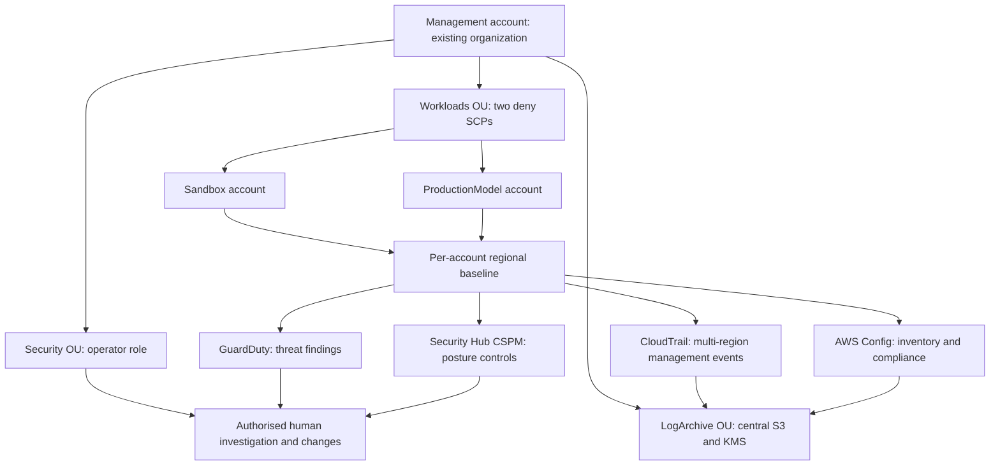

# AWS Security & Governance Hardening Lab

[](https://github.com/Srujal-Y/AWS-Security-Governance-Hardening-Lab/actions/workflows/ci.yml)

**AWS Organizations · SCPs · GuardDuty · Security Hub CSPM · AWS Config · CloudTrail · Terraform · Python**

A five-account governance model with deployable Terraform, shared audit storage, deny-based guardrails and repeatable offline security response exercises.

The lab separates **preventative controls** (SCPs), **audit evidence** (CloudTrail and Config), **detections and posture findings** (GuardDuty and Security Hub), and **reviewed response** (triage, approval, simulation, verification and rollback).

**No AWS account is needed for the offline demo or mocked tests. No AWS infrastructure has been deployed as part of this project's local validation.** Live deployment is a separate, chargeable AWS operation.

Local validation: **101 Python tests passed · 98.64% coverage · 10 Terraform mock tests passed**. Full evidence and remaining live checks are in [VALIDATION.md](docs/VALIDATION.md).

## What is implemented

| Area | Implementation |
| --- | --- |
| Organization model | Management, Security, LogArchive, Sandbox and ProductionModel accounts; Security, LogArchive and Workloads OUs |
| Region restrictions | Deny requests outside approved regions, with explicit global-service exceptions |
| Permissions guardrails | Protect selected security-service settings, governance roles and KMS administration; block member departure and root access-key creation |
| CloudTrail | One multi-region management-event trail per member account, digest validation and KMS-encrypted central S3 delivery |
| GuardDuty | Regional detector and S3 protection |
| Security Hub CSPM | Explicit AWS Foundational Security Best Practices subscription |
| AWS Config | Continuous recording, daily snapshots and six managed rules |
| Log archive | Central bucket, versioning, public-access blocks, TLS enforcement, KMS rotation and account-bound delivery permissions |
| Exercises | 27 SCP cases; four fictional finding/response workflows with before/after evidence |
| Live verification | Read-only checks of account identity, service enablement, standard readiness and Config rules |

The supplied Terraform targets the commercial `aws` partition. Existing accounts and an organization with all features enabled are prerequisites; the lab does not create accounts or move them between OUs automatically.

## Run the offline lab

Prerequisites: Python 3.11+; Terraform 1.9+ for infrastructure checks. The recorded local run uses Python 3.14 and Terraform 1.15.8.

### Windows PowerShell

```powershell
git clone https://github.com/Srujal-Y/AWS-Security-Governance-Hardening-Lab.git
cd AWS-Security-Governance-Hardening-Lab
python -m venv .venv
.\.venv\Scripts\python.exe -m pip install -r requirements.txt -r requirements-dev.txt
.\.venv\Scripts\python.exe -m pip install -e . --no-build-isolation --no-deps
.\.venv\Scripts\python.exe -m governance_lab demo --output reports/demo
Start-Process .\reports\demo\report.html
```

If you already have the project locally, start with `python -m venv .venv` from its folder. Environment activation is optional.

### Linux / macOS

```bash
git clone https://github.com/Srujal-Y/AWS-Security-Governance-Hardening-Lab.git
cd AWS-Security-Governance-Hardening-Lab
python3 -m venv .venv
.venv/bin/python -m pip install -r requirements.txt -r requirements-dev.txt
.venv/bin/python -m pip install -e . --no-build-isolation --no-deps
.venv/bin/python -m governance_lab demo --output reports/demo
```

Open `reports/demo/report.html` in a browser. Dependency/provider installation needs internet access; the installed offline exercise does not call AWS.

Expected output: **27/27 policy cases passed and 4/4 response exercises verified in memory**. Reports are generated as JSON, Markdown and standalone HTML. All findings, approvals and outcomes are explicitly labelled fictional.

See the [sample report](examples/demo/report.md), [HTML report](examples/demo/report.html) and [JSON evidence](examples/demo/report.json). Download HTML from GitHub and open it locally to see its formatting.

The reports include expected and observed policy decisions, severity-ranked findings, affected resources, risk and remediation guidance, and the simulated approval/verification history. JSON also retains the before/after state for each response exercise. Reusing an output directory replaces its report files.

## Architecture



The Security account provides the trusted operator identity. It is not automatically configured as a delegated administrator or finding aggregator. GuardDuty, Security Hub and Config remain regional/member-account deployments. The archive receives account-specific CloudTrail and Config records.

## Terraform stacks

| Stack | Run as | Purpose |
| --- | --- | --- |
| `infra/organization` | Management account | Create three lab OUs, render two SCPs, optionally attach them to Workloads |
| `infra/log-archive` | LogArchive account | Create a regional central S3/KMS delivery destination for explicitly listed accounts |
| `infra/account-baseline` | Each participating member account | Configure the four services; create the trusted governance administrator role in the primary region |

Use independent state per stack, account and region. Providers restrict execution to the expected account ID. Example variable files contain fictional IDs and must be replaced before a live plan.

**Deployment order:** review organization policies without attaching them → deploy the archive → bootstrap member baselines and administrator roles → verify service configuration and delivery → place approved accounts in the Workloads OU → attach SCPs and test a sandbox account.

Exactly one primary region per account creates the multi-region CloudTrail trail and global governance role. Secondary-region baselines use `primary_region = false`; deploy an archive in each baseline region. Configure every region you intend to monitor. Allowing a region in an SCP does not enable monitoring there.

For commands, role trust prerequisites, existing-resource imports, state isolation, costs and cleanup, follow [DEPLOYMENT.md](docs/DEPLOYMENT.md). No workflow runs `terraform apply`.

## Policy and response exercises

The Python evaluator consumes the **same policy templates as Terraform**, avoiding a second copy of the guardrails. It supports only the deny-policy constructs used in this lab and rejects unsupported syntax.

| SCP decision | Meaning |
| --- | --- |
| `explicit_deny` | At least one supplied lab statement matches the request |
| `not_denied_by_lab_scps` | These policies do not deny it; IAM permission is still required |
| `outside_scp_scope` | Modelled management-account or service-linked-role context |

SCPs do not grant permissions. The evaluator does not model the full organization policy hierarchy, resource policies, identity policies, permissions boundaries or session policies. Region controls restrict endpoints and do not establish data residency.

| Service fixture | Exercise |
| --- | --- |
| GuardDuty | Investigate a sample SSH brute-force finding and simulate an EC2 quarantine group |
| Security Hub | Review an S3.8 finding and simulate all four bucket public-access blocks |
| Config | Review missing ownership tags and simulate approved tag values |
| CloudTrail | Investigate a denied StopLogging request and verify that logging remains enabled |

Every workflow requires triage and a separate fictional reviewer before simulation. Tests cover refusal of self-approval, target/account mismatch, failed verification and rollback. The Python response engine has **no AWS mutation API path**.

To replay a modified fictional scenario:

```powershell
.\.venv\Scripts\python.exe -m governance_lab replay `
  --input src/governance_lab/data/scenario.json `
  --output reports/replay
```

| Exit code | Meaning |
| --- | --- |
| `0` | All requested checks passed within the declared scope |
| `1` | A policy expectation, response verification or live configuration check failed |
| `2` | Invalid input, incomplete AWS reads or an operational failure |

For command options, run `python -m governance_lab --help` using the virtual environment's Python. The separate `verify-live` command reads an exported Terraform service inventory; its setup and required account context are documented in [DEPLOYMENT.md](docs/DEPLOYMENT.md).

## Validate locally

```powershell
terraform -chdir=infra/organization init -backend=false -input=false
terraform -chdir=infra/log-archive init -backend=false -input=false
terraform -chdir=infra/account-baseline init -backend=false -input=false
.\.venv\Scripts\python.exe scripts/verify.py
.\.venv\Scripts\python.exe -m pip_audit -r requirements.txt --strict --disable-pip --no-deps
```

The verification command runs lint, Python tests, Terraform formatting/validation/mock tests, packaging and the offline demo. Terraform providers must first be initialised in all three roots; see the deployment guide's offline validation section.

CI is configured for credential-free Python checks and Terraform mock-provider tests. Hosted CI and real AWS validation are only claimed when separately recorded in [VALIDATION.md](docs/VALIDATION.md).

## Guides and evidence

- [Architecture, trust boundaries and design decisions](docs/ARCHITECTURE.md)
- [Deployment, validation and cleanup](docs/DEPLOYMENT.md)
- [SCP scope, exceptions and recovery](docs/GUARDRAILS.md)
- [Finding response and live acceptance exercises](docs/RESPONSE.md)
- [Validation record](docs/VALIDATION.md)
- [Security and data handling](SECURITY.md)

```text
infra/organization/       OUs and SCP deployment
infra/log-archive/        Shared encrypted delivery destination
infra/account-baseline/  Four-service configuration in each account/region
src/governance_lab/       Policy evaluator, response exercises, CLI and live reader
  policies/              Shared SCP templates
  data/                  Fictional account model, events and schema
tests/                   Python policy, workflow, report and AWS stub tests
examples/demo/           Fictional reports suitable for portfolio review
scripts/verify.py        Local validation entry point
.github/workflows/       Credential-free CI
```

This is a scoped governance lab. Production adoption requires authorised live validation, independent policy/security review, operational ownership and the organisation's approval process.

## License

[MIT](LICENSE).
